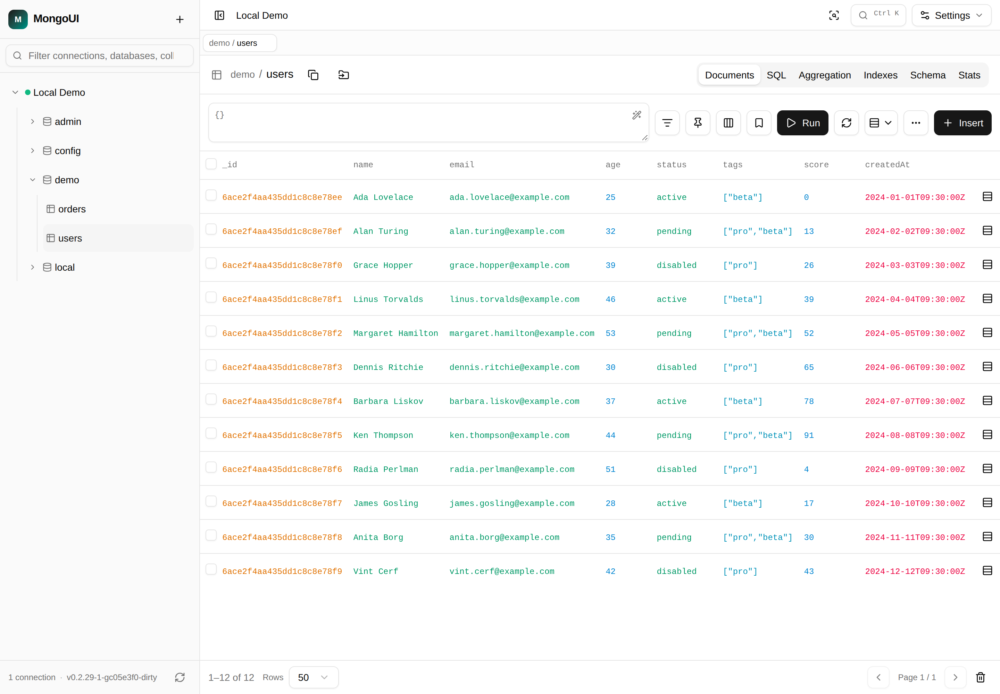

<div align="center">

# MongoUI

**轻量、自托管的 MongoDB Web 管理台 —— 一个二进制，开箱即用。**

[](https://github.com/dolphinZzv/mongoUI/actions/workflows/ci.yml)
[](https://github.com/dolphinZzv/mongoUI/releases)
[](backend/go.mod)
[](https://pnpm.io)
[](https://github.com/dolphinZzv/mongoUI/pkgs/container/mongoui)
[](LICENSE)

[功能特性](#功能特性) · [快速开始](#快速开始) · [使用指南](#使用指南) · [MCP 与 Agent](#mcp-与浏览器-agent) · [配置](#配置) · [安全](#安全说明)

</div>

---

## 简介

MongoUI 是一个用 Go + React 编写的 MongoDB 可视化管理工具。前端构建产物通过 `go:embed` 内嵌进 Go 二进制，**单文件部署、无需 Node 运行时或独立静态服务器**，适合在本地、内网或容器里长期常驻。

除常规的数据浏览与增删改查外，MongoUI 着重打磨了「日常查库的效率」：可视化查询构造器、命名视图、跨页批量更新、跨集合全文搜索、SQL 查询、执行计划与索引建议，并内置 **MCP server** 与**浏览器 Agent** 通道，让 AI 助手可以直接操作你的 MongoDB。

> 所有 BSON 值在前后端之间以 **MongoDB Extended JSON（relaxed）** 传输，`ObjectId` / `Date` / `Decimal128` / `Long` / `Binary` 等类型无损保留。

```json
{ "_id": { "$oid": "507f1f77bcf86cd799439011" }, "createdAt": { "$date": "2024-01-01T00:00:00Z" } }
```

## 界面预览



右上角的 **设置** 菜单汇集了主题与语言、浏览器 Agent、MCP 开关、自动更新，以及账号与定时备份管理；`Ctrl/⌘ + K` 打开命令面板，可快速跳转连接、切换标签页、打开固定查询。顶栏的终端按钮打开右侧可折叠的**脚本控制台**，可直接运行 mongosh 风格脚本。

## 功能特性

### 浏览与查询

- **文档浏览器**：树形导航数据库 / 集合，支持过滤、排序、投影、分页（每页 25–250），列宽 / 列序 / 显隐 / 固定列按集合记忆（`_id` 默认固定在左侧），离屏行按需渲染。
- **过滤器编辑器**：MongoDB 语法高亮、操作符与字段名自动补全、常用模板，零第三方编辑器依赖。
- **可视化查询构造器**：字段 / 运算符 / 值逐条添加，支持嵌套 AND / OR 分组；根据字段类型提供 ObjectId、日期、布尔、数字等类型化输入与校验；可视化选择返回列（投影）；实时预览 JSON。
- **自然语言生成过滤**：输入「状态 = 失败 且 时间 > 2024-01-01」「status = active and age >= 18」即可生成条件（本地规则解析，中英文皆可）。
- **命名视图**：把「过滤 + 排序 + 投影 + 每页条数」保存为命名视图，随时复用或固定到侧栏；也支持查询历史与收藏。
- **高效操作**：命令面板（`Ctrl/⌘ + K`）、表格快捷键（`j/k` 移动、`Space` 选择、`e` 编辑、`Delete` 删除、`/` 聚焦过滤）、单元格右键复制（值 / JSON / 字段名 / `_id` / `$set` 片段）、删除撤销、跨页「全选匹配」与按过滤批量更新。
- **多标签页**：同时打开多个集合为标签，切换 / 关闭并恢复上次的标签与过滤条件。

### 分析与洞察

- **SQL 查询**：用 SQL 查询 MongoDB，自动翻译为 find / aggregation，并展示生成的 MQL；支持 `WHERE / IN / LIKE / GROUP BY / HAVING / DISTINCT / 聚合函数`。
- **脚本控制台**：右侧可折叠面板，直接运行 mongosh 风格脚本（`db.users.find(...)`、`updateMany`、`aggregate`、`createIndex` 等），支持多语句、`ObjectId()` / `ISODate()` / `NumberLong()` / `NumberDecimal()` 等构造器，结果以 JSON 查看；写操作同样受只读连接与账号角色限制，并计入审计。
- **聚合管道**：多行 JSON 编辑器 + 常用模板，表格 / JSON 结果视图，一键复制为 `db.<c>.aggregate(...)`。
- **执行计划（Explain）**：对 find / 聚合运行 `explain`，展示关键指标；当命中全表扫描时给出**索引建议并可一键创建**，超过 100ms 的查询会标记为慢查询。
- **查询结果可视化**：把结果切换为柱状 / 折线 / 面积 / 饼图，自选 X 轴与数值聚合，纯 SVG 实现、无额外依赖。
- **全库搜索**：在一个数据库的所有集合中按「值」或「字段名」模糊搜索，给出每个集合的命中数与样例，快速定位数据位置。
- **导出为 SQL / mongosh**：把当前查询导出为 SQL `SELECT` 或 `db.<c>.find(...)` 片段，方便沉淀为脚本。

### 数据管理

- 插入（支持数组批量）、整文档编辑、单条 / 批量 / 按条件删除。
- JSON（Extended JSON 数组或 NDJSON）与 CSV 导入 / 导出，导出可套用当前过滤 / 排序 / 投影。
- 集合复制 / 迁移到同一连接的其它库或集合，可选复制索引、先清空目标。
- 完整的**索引编辑器**：复合键（升/降序、text、hashed、2dsphere、2d）、唯一 / 稀疏 / 隐藏 / TTL / 部分索引 / collation / 全文权重等，附原始 JSON 模式。
- Schema 抽样分析、`collStats` / `dbStats` 统计、服务器信息。

### 集成与运维

- **MCP server**：内置 Model Context Protocol（stdio / HTTP），工具分读 / 写两组，可分别开关。
- **浏览器 Agent（WebMCP）**：把连接 / 查询 / 聚合 / 索引等操作暴露给浏览器内 agent，默认关闭、需显式开启。
- **写操作审计**：记录通过界面或 API 执行的成功写操作（连接 / 库 / 集合 / 操作 / 状态），并持久化到服务端。
- **多账号与角色**：多个 TOTP 账号，分 `管理员 / 读写 / 只读` 角色；只读账号的写操作在服务端被拒。
- **单点登录（OIDC）**：接入任意 OpenID Connect 提供方，支持发现、PKCE、JWKS 校验与「用户组 → 角色」映射，可限制邮箱域名 / 邮箱。
- **定时备份**：按计划把集合导出为 JSON/CSV 文件，保留最近若干份，并记录上次运行状态。
- **登录与两步验证（TOTP）**、后退 / 前进与刷新可恢复的 URL 状态。
- 守护进程（`-daemon`）、一键安装脚本、Homebrew formula（`brew services`）、Docker 镜像与**内置自动更新**。

## 快速开始

### 环境要求

- Go 1.26+
- Node.js 24+ 与 [pnpm](https://pnpm.io) 12+
- 一个可访问的 MongoDB（本地、Docker 或 Atlas 均可）

仓库根目录的 `mise.toml` 锁定了 Node、pnpm 与 Go 的版本，推荐用 [mise](https://mise.jdx.dev/) 一次性安装并对齐版本：

```bash
mise install        # 按 mise.toml 安装 node / pnpm / go
```

> 不使用 mise 时，也可自行安装 Node 24+ 与 pnpm，并在 `frontend/` 下执行 `pnpm install`。

### 生产模式（单二进制）

```bash
make build     # 构建前端 → 复制到 backend/web/dist → 编译 Go
make run       # 默认监听 :8080，数据目录 ./data
```

打开 <http://localhost:8080>。

### 开发模式（前后端分离）

```bash
make install        # 安装前端依赖

# 终端 1：后端（:8080）
make dev-backend

# 终端 2：前端（:5173，已配置 /api 代理到 :8080）
make dev-frontend
```

打开 <http://localhost:5173>。

### 本地 MongoDB

```bash
make docker-mongo   # docker run -p 27017:27017 mongo:8
```

## 安装

### 一键安装（GitHub Releases）

无需 Go / Node 环境，直接下载对应平台的预编译二进制（已内嵌前端）：

```bash
curl -fsSL https://raw.githubusercontent.com/dolphinZzv/mongoUI/main/scripts/install.sh | sh
```

指定版本、目录，或顺便安装 systemd 服务：

```bash
# 指定版本与安装目录
curl -fsSL https://raw.githubusercontent.com/dolphinZzv/mongoUI/main/scripts/install.sh \
  | sh -s -- --version v0.2.25 --dir "$HOME/.local/bin"

# 或先下载脚本再执行（避免管道问题）
curl -fsSL -o install.sh https://raw.githubusercontent.com/dolphinZzv/mongoUI/main/scripts/install.sh
sh install.sh --dir /usr/local/bin --service
```

脚本自动识别 `linux/darwin` × `amd64/arm64`，下载归档并用 `checksums.txt` 校验 SHA-256。

### Docker

镜像已内嵌前端，单容器即可运行；连接配置持久化在 `/data` 卷。

```bash
docker run -d --name mongoui -p 8080:8080 -v mongoui-data:/data \
  ghcr.io/dolphinzzv/mongoui:latest

# 或使用仓库内的 compose
docker compose up -d
```

对公网暴露时建议同时设置 MCP 令牌：

```bash
docker run -d -p 8080:8080 -v mongoui-data:/data \
  -e MONGOUI_MCP_TOKEN=change-me \
  ghcr.io/dolphinzzv/mongoui:latest
```

> 容器内连接宿主机 MongoDB：Linux 下用 `--network host`，或把连接串指向宿主机 IP；Docker Desktop 用 `host.docker.internal:27017`。

### Homebrew（macOS / Linuxbrew）

```bash
brew tap dolphinZzv/tap
brew install mongoui
brew services start mongoui     # 后台常驻，默认 127.0.0.1:8080
brew services stop mongoui
```

数据目录默认为 `$(brew --prefix)/var/mongoui`。

### 从源码构建

```bash
git clone https://github.com/dolphinZzv/mongoUI.git
cd mongoUI
mise install
make build        # 产出 bin/mongoui（内嵌前端）
./bin/mongoui -addr :8080 -data ./data
```

## 使用指南

### 文档页与查询构造器

文档页的过滤框是一个轻量 MongoDB 过滤器编辑器，支持高亮、补全与模板：

```json
{ "status": "paid", "total": { "$gte": 100 }, "createdAt": { "$gte": { "$date": "2024-01-01T00:00:00Z" } } }
```

点击工具栏的构造器按钮可打开可视化面板：按「字段 / 运算符 / 值」添加条件、用 AND / OR 分组，并根据字段类型提供类型化输入；也可以直接输入一句自然语言生成条件。面板内还能选择返回哪些列（投影），并实时预览最终 JSON。

把当前「过滤 + 排序 + 投影 + 每页条数」保存为**命名视图**，下次一键复用；视图也可固定到左侧边栏，或直接固定当前过滤条件。

### SQL 查询

集合视图的 **SQL** 标签页支持用 SQL 查询 MongoDB（`Ctrl/⌘ + Enter` 运行），翻译为 find / aggregation 执行，并展示生成的 MQL：

```sql
SELECT status, COUNT(*) AS n, SUM(total) AS revenue
FROM orders
WHERE total > 0
GROUP BY status
HAVING n > 1
ORDER BY revenue DESC
LIMIT 20
```

支持范围：

- `SELECT` / `SELECT DISTINCT`，字段别名 `AS`
- `WHERE`：`= != <> > >= < <=`、`IN` / `NOT IN`、`LIKE` / `NOT LIKE`、`IS [NOT] NULL`、`AND` / `OR` / `NOT`、括号
- `ORDER BY ... [ASC|DESC]`、`LIMIT n [OFFSET m]`（也支持 MySQL 的 `LIMIT m, n`）
- `GROUP BY` / `HAVING`，聚合函数 `COUNT / SUM / AVG / MIN / MAX`
- 点号字段路径（如 `address.city`）

### 导入 / 导出与集合复制

| 操作 | 接口 | 说明 |
| --- | --- | --- |
| 导出 | `POST .../export` | body `{ format: "json"\|"csv", filter?, sort?, projection?, limit? }`，返回文件名、MIME 与内容 |
| 导入 | `POST .../import` | body `{ format: "json"\|"csv", content, drop? }`；JSON 支持数组或 NDJSON，CSV 自动推断类型 |
| 复制 | `POST .../copy` | body `{ targetDatabase, targetCollection, filter?, dropTarget?, copyIndexes? }` |

### 执行计划与索引建议

在文档页 / 聚合页对当前查询运行 `explain`（`queryPlanner` / `executionStats` / `allPlansExecution`），查看耗时、扫描索引键 / 文档数、返回条数与完整计划 JSON。当计划为全表扫描时，MongoUI 会依据过滤与排序字段给出复合索引建议，并可一键创建。

### URL 路由与状态保持

当前视图会写入 URL，刷新、分享链接、浏览器前进 / 后退均可恢复：

| 视图 | URL |
| --- | --- |
| 首页 | `/` |
| 连接概览 | `/connections/{connectionId}` |
| 集合视图 | `/connections/{connectionId}/databases/{db}/collections/{collection}` |
| 集合标签页 | 上表 URL 后追加 `?tab=documents\|sql\|aggregation\|indexes\|schema\|stats` |
| 文档查询 | 集合 URL 后追加 `?filter=...&sort=...&projection=...&limit=...&skip=...` |

侧边栏展开状态、主题、语言、打开的多标签页、列偏好等都保存在浏览器 `localStorage`。

## MCP 与浏览器 Agent

让 AI 助手直接操作 MongoDB，无需自己管理连接。

### MCP（Model Context Protocol）

内置 MCP server，Claude Desktop、Cursor、Cline 等可通过 MCP 浏览库 / 集合、查询、聚合、SQL、explain、增删改与索引管理。

- **stdio**：`mongoui mcp`（本地子进程，共用 `-data` 目录里的连接配置）
- **HTTP（Streamable HTTP）**：运行中的服务在 `POST /mcp` 提供端点

```jsonc
// 完整示例见 examples/ 与 docs/mcp.md
{
  "mcpServers": {
    "mongoui": { "type": "http", "url": "http://localhost:8080/mcp" }
  }
}
```

工具分为**读**与**写**两组，可在界面「设置」里分别开关；**开启 MCP 时默认只开读分组**，写分组需显式开启。设置保存在 `<data>/settings.json`，stdio 与 HTTP 共用。旧的 `-mcp-readonly` / `MONGOUI_MCP_READONLY=1` 仍然兼容（等价于关闭写分组）。详见 [docs/mcp.md](docs/mcp.md)。

### 浏览器 Agent（WebMCP）

把一组操作暴露给**浏览器内的 agent**，无需额外部署。该能力**默认关闭**，需在「设置」里手动开启，关闭后立即注销。

- **WebMCP**：当浏览器提供实验性的 `navigator.modelContext` 时自动注册工具。
- **兜底通道**：开启后始终暴露 `window.mongouiAgent`：

```js
window.mongouiAgent.tools                       // [{ name, description }]
await window.mongouiAgent.call("mongoui_list_connections")
await window.mongouiAgent.call("mongoui_find", {
  connectionId: "<id>", database: "demo", collection: "users",
  filter: { age: { $gte: 30 } }, limit: 20,
})
```

所有调用都走同一个后端 REST API，仍受只读模式与后端校验约束；完整列表见 `frontend/src/lib/agentTools.ts`。

## 登录、账号与权限

首次打开界面会引导开启 TOTP：用验证器 App 扫描二维码（或手动输入密钥），输入 6 位验证码即启用，并创建第一个**管理员**账号。之后每次访问都需用「用户名 + 验证码」登录，会话由 **HttpOnly + SameSite=Strict 的签名 Cookie** 维持（默认 30 天）。

账号分三种角色，均可在右上角 **设置 → 账号** 中管理（管理员专属）：

| 角色 | 权限 |
| --- | --- |
| `admin` | 全部权限，包含账号与定时备份管理 |
| `readwrite` | 读写数据，不能管理账号 |
| `readonly` | 只读；写操作在服务端返回 403 |

- 添加账号：填写用户名与角色，用验证器扫码并输入验证码激活；系统始终保留至少一个管理员。
- 启用后所有 `/api/*` 需要登录（`/api/health` 除外）；静态前端不受影响，登录页始终能打开。
- 密钥经 AES-256-GCM 加密后保存在 `<data>/auth.json`；会话签名密钥由主密钥派生（`MONGOUI_SECRET_KEY`），**更换主密钥会导致会话失效并需重新登录**。旧的单账号配置会自动迁移为一个名为 `admin` 的管理员。
- 启用 TOTP 后 `/mcp` 不在会话保护范围内，请务必设置 `MONGOUI_MCP_TOKEN`，否则 agent 端点等于无鉴权（启动时会有告警日志）。
- 重置：删除 `<data>/auth.json` 重启，会重新进入首次设置。

### 单点登录（OIDC）

在 **设置 → 单点登录（OIDC）**（管理员专属）中配置任意符合 OpenID Connect 的提供方：

- **Issuer**：提供方的基础地址，元数据自动从 `/.well-known/openid-configuration` 发现（端点、JWKS 地址）。
- **Client ID / Client secret**：授权码流程使用 **PKCE（S256）**，令牌端点认证支持 `client_secret_basic`（默认）与 `client_secret_post`。
- **回调地址**：默认 `https://<你的域名>/api/auth/oidc/callback`，需在提供方后台登记为允许的回调；如经反向代理请设置 `X-Forwarded-Proto` / `X-Forwarded-Host`，或在此显式覆盖。
- **角色映射**：按用户组（默认 `groups`，也兼容 `roles`）映射到 `admin` / `readwrite` / `readonly`，优先级为管理员 > 读写 > 只读；未命中时使用默认角色，也可勾选「必须匹配用户组」直接拒绝。
- **身份字段**：用户名默认依次尝试 `preferred_username` → `email` → `upn` → `sub`，可自定义。
- **访问控制**：可限定允许的邮箱域名 / 具体邮箱，并要求邮箱已验证（`email_verified`）。
- **账号**：首次登录默认自动创建账号（角色随组同步），也可关闭自动创建，改由管理员预先建号；账号列表会标注来源为 `TOTP` 或 `OIDC`。

> ID Token 的 `iss` / `aud` / `exp` / `nonce` 与签名（RS/PS/ES/EdDSA）都会在服务端校验；客户端密钥以 AES-256-GCM 加密后存入 `<data>/auth.json`。启用 OIDC 后登录页会出现「使用 … 登录」按钮，TOTP 登录仍可同时使用。

## 配置

通过命令行参数或环境变量配置：

| 参数 | 环境变量 | 默认值 | 说明 |
| --- | --- | --- | --- |
| `-addr` | `MONGOUI_ADDR` | `:8080` | HTTP 监听地址 |
| `-data` | `MONGOUI_DATA` | `data` | 连接配置存储目录（`connections.json`） |
| `-web` | — | 空 | 从指定目录提供前端资源（覆盖内嵌版本） |
| `-mcp-readonly` | `MONGOUI_MCP_READONLY` | 关 | 兼容参数：等价于关闭 MCP 写分组 |
| `-mcp-token` | `MONGOUI_MCP_TOKEN` | 空 | `/mcp` 的 Bearer 令牌（非空时校验） |
| `-tls-cert` | `MONGOUI_TLS_CERT` | 空 | TLS 证书；与 `-tls-key` 同时设置时启用 HTTPS |
| `-tls-key` | `MONGOUI_TLS_KEY` | 空 | TLS 私钥 |
| — | `MONGOUI_KNOWN_HOSTS` | `~/.ssh/known_hosts` | SSH 跳板机主机密钥校验文件 |
| — | `MONGOUI_SECRET_KEY` | 自动生成 | 加密连接密钥的主密钥（32 字节 hex/base64）；不填则用 `<data>/secret.key` |
| — | `MONGOUI_ALLOW_ORIGIN` | 空 | 允许跨域访问的来源（逗号分隔）；默认仅同源 |

```bash
./bin/mongoui -addr :9000 -data /var/lib/mongoui
```

### SSH 隧道（跳板机）

在连接编辑弹窗里打开 **SSH tunnel**，即可通过跳板机访问内网 MongoDB —— MongoDB 无需对运行 MongoUI 的机器开放，驱动会把每个 TCP 连接交给 SSH 服务器转发。

| 字段 | 说明 |
| --- | --- |
| SSH host / port | 跳板机地址，默认端口 `22` |
| SSH user | 登录用户名 |
| Authentication | `Password` 或 `Private key`（PEM / OpenSSH，可带 passphrase） |
| known_hosts file | 可选；留空时依次回退到 `MONGOUI_KNOWN_HOSTS`、`~/.ssh/known_hosts` |

> 主机密钥默认**严格校验**；仅当上述文件都不存在时，才回退到「接受任意主机密钥」并打印警告。

`mongodb+srv://` 同样可用：SRV 解析在本机完成，随后由 SSH 服务器去连接解析出的节点。

### 后台运行（守护进程）

```bash
mongoui -addr :8080 -daemon     # 后台启动
mongoui -status                 # 查看运行状态
mongoui -stop                   # 停止
```

- pid 默认 `<data>/mongoui.pid`，日志默认 `<data>/mongoui.log`，可用 `-pidfile` / `-logfile` 覆盖。
- Windows 不支持 `-daemon`，请使用 NSSM、任务计划程序或 Windows 服务。

### 自动更新

服务内置定时自更新：**默认每 10 分钟**检查一次 GitHub Releases，发现新版本会下载、校验 SHA-256 并原子替换二进制。可在「设置 → Updates」中关闭或调整间隔（最小 5 分钟）。

```bash
mongoui update            # 更新到最新版本
mongoui update -check     # 只检查是否有新版本
mongoui update -force     # 已是新版也重新安装
mongoui update -version v0.2.25
```

配置保存在 `<data>/settings.json` 的 `update` 字段；仓库地址可用 `-repo owner/name` 或 `MONGOUI_REPO` 覆盖。更新后需重启进程。

## 安全说明

- **凭据加密**：连接串（含账号密码）与 SSH 密码 / 私钥在 `connections.json` 中以 **AES-256-GCM** 存储（`enc:v1:` 前缀）。主密钥来自 `MONGOUI_SECRET_KEY`，未设置时首次启动自动生成 `<data>/secret.key`（权限 `0600`）。**请务必备份主密钥或 `secret.key`，丢失后将无法解密连接配置。** 旧版明文配置会在启动时自动加密。
- **只读模式**：在网页端、HTTP API 与 MCP 写工具中均**服务端强制生效**（对只读连接的写操作返回 403，包括聚合里的 `$out` / `$merge`）。
- **默认同源**：跨域默认关闭；如需让其他源访问 API / MCP，请设置 `MONGOUI_ALLOW_ORIGIN`（逗号分隔）。
- **请求约束**：请求体限制 32MB，聚合结果默认限量，服务端设置读 / 写 / 空闲超时，并返回 `X-Content-Type-Options` / `X-Frame-Options` / `Referrer-Policy` 等响应头。
- **凭据脱敏**：连接列表接口对 URI 密码与 SSH 凭据脱敏（密码显示为 `xxxxxxxx`、SSH 密钥清空）；完整凭据仅在编辑弹窗按单个连接获取。
- **登录**：首次启动强制引导设置 TOTP，之后所有 `/api/*` 需要登录会话（`/api/health` 除外）。可额外启用 **OIDC 单点登录**（授权码 + PKCE + JWKS 校验），其回调同样受签名 Cookie 会话保护。
- **MCP**：`/mcp` 默认无鉴权，对外暴露时请设置 `MONGOUI_MCP_TOKEN`，并可在界面关闭写分组或整体关闭 MCP。

> 不建议把 `data/` 提交到版本库（已在 `.gitignore` 中忽略），也只建议在可信网络 / 反向代理鉴权之后暴露服务。

## 架构

```
mongoUI
├── backend/                 Go 服务
│   ├── internal/api/        HTTP 路由与处理器（REST）
│   ├── internal/mcp/        MCP server（stdio / HTTP）
│   ├── internal/mongoclient 连接管理（含 SSH 隧道）
│   ├── internal/config      连接 / 设置持久化与加密
│   └── web/                 go:embed 前端构建产物
├── frontend/                React + TypeScript 单页应用
│   └── src/
│       ├── components/      UI（shadcn/ui + Radix）
│       ├── hooks/           数据查询与 Agent 工具
│       └── lib/             API 客户端、路由、解析器
├── scripts/                 构建 / 开发 / 安装脚本
└── mise.toml                工具链版本（Node / pnpm / Go）
```

- 前端构建产物经 `go:embed` 打包进二进制；`backend/web/dist` 保留 `.gitkeep`，保证未构建前端时 `go build` 仍可用。
- 所有 BSON 值以 Extended JSON 传输，保证类型无损。
- 后端对每个连接做只读与校验控制，UI、REST、MCP、浏览器 Agent 共用同一套接口，没有特权旁路。

## 开发与发布

```bash
make help        # 查看所有命令
make install     # 安装前端依赖（pnpm）
make build       # 构建单文件二进制
make test        # 运行后端单元测试
make vet         # go vet
make fmt         # gofmt
make clean       # 清理构建产物
```

**CI**（`.github/workflows/ci.yml`）在 push / PR 时：校验 `go mod tidy`、`go vet`、`go test -race`（上传覆盖率）、前端 `tsc --noEmit` + `vite build`，并构建单文件二进制做冒烟检查（`/api/health` 返回 `uiEmbedded:true`、首页可访问）。

**Release**（`.github/workflows/release.yml` + `.goreleaser.yaml`）在推送 `v*` tag 时触发 GoReleaser：先构建并嵌入前端，再交叉编译 linux / macOS / Windows（amd64、arm64），生成归档、`checksums.txt` 与 changelog，发布到 GitHub Releases；同时构建并推送 Docker 镜像到 GHCR。

发布新版本：

```bash
./scripts/sync-version.sh v0.2.26   # 同步 frontend/package.json 版本（必须与 tag 一致）
git commit -am "chore: release v0.2.26"
git tag v0.2.26
git push origin main v0.2.26
```

> `frontend/package.json` 版本必须与 tag 一致：CI 会在 tag 构建时校验，`scripts/build.sh` 也会拒绝内嵌过期前端的构建。Release 会在构建前自动同步一次。

## 常见问题

**Q：连接配置 / 凭据放在哪里？**
`<data>/connections.json`（默认 `./data`），凭据以 AES-256-GCM 加密。换机器时连同 `secret.key`（或 `MONGOUI_SECRET_KEY`）一起迁移。

**Q：忘了 TOTP / 登录不进去？**
删除 `<data>/auth.json` 后重启，会重新进入首次设置。

**Q：Windows 上能后台常驻吗？**
`-daemon` 仅支持 Unix；Windows 请用 NSSM 或 Windows 服务。

**Q：容器里连不上宿主机 MongoDB？**
Linux 用 `--network host`，或把连接串指向宿主机 IP；Docker Desktop 用 `host.docker.internal:27017`。

**Q：`/mcp` 需要鉴权吗？**
默认没有，请设置 `MONGOUI_MCP_TOKEN`，或仅在内网 / 反向代理之后暴露。

## 贡献

欢迎 Issue 与 PR。提交前请确保：

```bash
cd backend && go vet ./... && go test ./...
cd frontend && pnpm run build      # tsc + vite
```

前端与后端都在 `mise.toml` 固定了工具链版本，运行 `mise install` 即可对齐。

## 技术栈与致谢

Go · [chi](https://github.com/go-chi/chi) · [mongo-go-driver](https://github.com/mongodb/mongo-go-driver) ·
React 19 · TypeScript · [Vite](https://vitejs.dev/) · Tailwind CSS v4 · [Radix UI](https://www.radix-ui.com/) / [shadcn/ui](https://ui.shadcn.com/) ·
[lucide](https://lucide.dev/) 图标 · [sonner](https://sonner.emilkowal.ski/) 提示

## 路线图

- 定时备份的历史记录浏览 / 下载与失败重试
- 跨连接迁移的断点续传与限速
- 更细粒度的连接级 ACL（按账号授权可访问的连接）
- 账号操作的审计记录（登录、创建 / 删除账号）

## 许可证

本项目基于 [MIT License](LICENSE) 开源。
